# Architecture

How Tarmar Studio is put together, from the machines it runs on down to the
Games Master's turn engine. Every claim here names a path you can open. Where a
diagram simplifies, the prose beside it says what it left out.

`docs/project-structure.md` is the map of *what lives where*. This document is
the map of *how the parts reach each other*.

Contents:

1. [System context](#1-system-context)
2. [Application map](#2-application-map)
3. [Request and auth flow](#3-request-and-auth-flow)
4. [The character generator](#4-the-character-generator)
5. [The battle engine](#5-the-battle-engine)
6. [The Games Master](#6-the-games-master)
7. [Data model overview](#7-data-model-overview)
8. [Testing and quality gates](#8-testing-and-quality-gates)
9. [Deployment and operations](#9-deployment-and-operations)
10. [Where to look](#10-where-to-look)

---

## 1. System context

One Django project, `tarmar_studio`, serves every feature. In production it runs
on the host **datahorde** behind nginx, in two interchangeable colours; the
language model it talks to runs on a separate Mac Studio reached by the name
`tarmar-llm`.

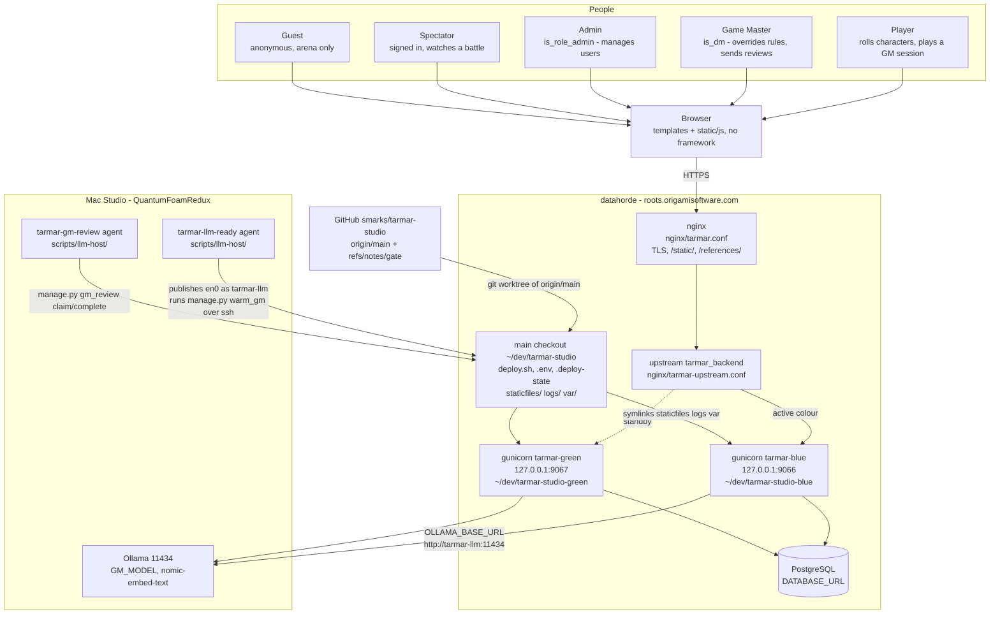

Checkable points:

- The two units and their ports are rendered from one file,
  `tarmar.service.template` (`__COLOUR__`, `__PORT__`, `__RELEASE_DIR__`,
  `__APP_DIR__`), by `deploy.sh install_unit`. Ports are `BLUE_PORT=9066` /
  `GREEN_PORT=9067` in `deploy.sh`.
- The switch is a one-line file: `switch_to` rewrites
  `/etc/nginx/conf.d/tarmar-upstream.conf` with
  `upstream tarmar_backend { server 127.0.0.1:$port; }`, then `nginx -t` and
  `systemctl reload nginx`. The repo copy is `nginx/tarmar-upstream.conf`.
- `staticfiles/`, `logs/` and `var/` are symlinked from each release checkout
  back to the main checkout (`SHARED_DIRS` in `deploy.sh`), so nginx serves one
  `staticfiles/` and both colours read one `var/gm-index.json`.
- The model host is reached by name, not address: `.env` carries
  `OLLAMA_BASE_URL=http://tarmar-llm:11434`, and
  `scripts/llm-host/tarmar-llm-ready.sh` rewrites datahorde's `/etc/hosts`
  entry when the Mac's DHCP lease changes. The one HTTP client is
  `common/services/ollama_client.py`.
- `/health/` is `tarmar_studio/urls.py::health_check`; it runs `SELECT 1`, so a
  200 proves Django and the database together. `scripts/health_check.py` probes
  it per port during a deploy.

### Who the users are

Roles are three boolean fields on the user row plus one derived property
(`accounts/models.py` subclasses `origami_auth.base.AbstractOrigamiUser`):

| Role | Field | What it unlocks |
| --- | --- | --- |
| Player | `is_player` (default `True`) | own characters, parties, battles, GM sessions |
| Game Master | `is_dm` | DM-only reference pages, bestiary/encounters/ruins tools, GM authority in a session, "Send to Claude" reviews, control of any battle |
| Admin | `is_role_admin` | user administration; with `is_dm` it forms `can_manage_users` |
| Spectator | none | not a role — a signed-in viewer with no seat; `battle/views.py` sets `is_spectator` |
| Guest | none | anonymous; may create and play arena battles only, bounded by `battle/limits.py` |

`can_manage_users` is a property, `is_role_admin or is_dm`. GM authority is read
from the account, never from the request body:
`gm/services.py::get_system_message` calls `battle.access.is_dm(user)`.

### The passphrase gate

`common/middleware.py::PublicPathPassphraseMiddleware` subclasses
`speak_friend.middleware.PassphraseMiddleware` and sits between CSRF and
authentication in `settings.MIDDLEWARE`. A `POST /gate/` is intercepted by the
middleware — there is no `/gate/` route in `tarmar_studio/urls.py`. The answer
is compared as a SHA-256 of the normalised string
(`common/gate.py::normalize_passphrase`, `strip().lower()`), and a pass sets the
session flag `passphrase_authenticated`.

The gate is not in front of *quite* everything. `common/public_paths.py` carves
out `PUBLIC_PATH_PREFIXES = ("/tarmar/battles/", "/tarmar/accounts/login/",
"/tarmar/accounts/logout/", "/tarmar/accounts/register/")` and
`PUBLIC_PATHS_EXACT = ("/",)`, plus `/health/` from speak_friend's own
`EXEMPT_PATHS`. Registration being public is deliberate: the gate is a doorway,
not an invite code. The subclass exists because `login()` and `logout()` cycle
the session — it re-plants the flag on a public path when the response dropped
it.

Wrong guesses are counted per client address by
`common/middleware.py::GateRateLimitMiddleware`, which sits outside the gate in
`settings.MIDDLEWARE`. From `settings.GATE_HINT_AFTER_WRONG_GUESSES` wrong
guesses on, the refusal carries a hint, and so does the 429 once the guessing
budget is spent; each is drawn at random (`common/gate.py::choose_gate_hint`)
from `settings.GATE_HINTS`, which `load_gate_hints` reads at startup from
`config/gate-hints.txt` (the `GATE_HINTS_FILE` environment variable names
another file). The hints are configuration, not code (issues #55, #77).

---

## 2. Application map

Seventeen entries in `INSTALLED_APPS` (`tarmar_studio/settings.py`), eleven of
them local, plus the shared frontend.

| App | One line |
| --- | --- |
| `tarmar_studio` | Project config: settings, root URLconf, `health_check`, wsgi/asgi. |
| `accounts` | The `User` model (`db_table = "accounts_user"`) and the auth pages, thin subclasses of `origami_auth.views`. |
| `common` | Everything shared: gate and public paths, rate limiting, dice rolling, the Ollama client, SSE helpers, mixins, breadcrumbs, themes, guest keys. |
| `characters` | The `Character` record and the whole rules engine — attributes, skills, experience, equipment, movement, attack resolution. |
| `character_export` | Read-only Markdown / JSON / PDF export; no models. |
| `parties` | `Party` + `PartyMembership` — a named group of characters. |
| `battle` | The hex arena: setup drafts, seats, control modes, turn advance, event log, spectating. |
| `encounters` | DM encounter generator, d20 main table plus d10 subtables per terrain; no models. |
| `ruins` | DM ruin and adventure-hook generators, parsed out of the reference markdown; no models. |
| `bestiary` | The `Beast` catalog, TFT-to-Tarmar stat translation, variant generation, SVG plates. |
| `gm` | The Games Master: sessions, the plan/run/narrate turn engine, campaign records, canon retrieval, transcripts, reviews. |
| `reference` | The rules wiki: a markdown tree under `reference/content/` with a hand-kept nav and an in-memory search index. |
| `cli` | Offline terminal GM (`tarmar play`); shares the prompt, the dice and the retrieval index with the web GM, not the turn engine. |
| `static/js` | Plain ES5-ish browser modules, no build step: `api.js` underneath everything, then the arena, the sheet and the chat. |
| `templates` | `base.html`, `landing.html`, `gate.html`, error pages; per-app templates live in each app. |

### Dependencies

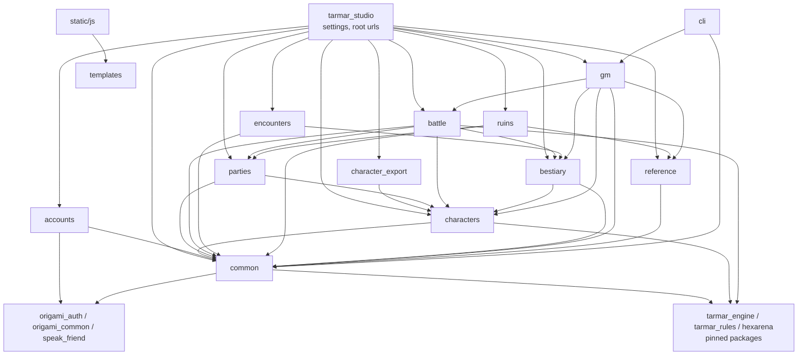

Notes on the edges, each checkable:

- `characters`, `accounts` and `common` import nothing from `battle`,
  `parties`, `ruins` or `encounters` at module level. The rules engine does not
  know the arena exists.
- `gm` is the widest consumer: `gm/fight.py` and `gm/views.py` import
  `battle.profiles`, `battle.models`, `battle.services.create_battle`,
  `battle.access.is_dm` and `battle.views.arena_context`; `gm/roster.py` and
  `gm/turn_engine/executor.py` drive `characters.services`.
- `battle` reaches `parties` only through deferred imports
  (`battle/services.py`, `battle/views.py`) for party import into a setup draft.
- `battle/engine/*.py`, `battle/policy.py` and `battle/spells.py` are pure
  re-exports of the pinned `tarmar_engine` package; `characters/combat.py` is
  mostly a re-export of `tarmar_rules` through `tarmar_engine.resolution`. The
  classic *Melee* adapter (`battle/classic_adaptation.py`) imports its
  subpackage lazily, inside each call, to keep that code quarantined.
- `ruins/tables.py` and `ruins/hooks.py` parse the loaded canon's
  `gm-tools/*.md` (`reference.paths.GM_TOOLS_DIR`) at load, so the generators
  cannot drift from the published tables. `gm/maps.py` builds its place
  registry from the gazetteer the canon's `maps.json` names for the same
  reason.
- `battle/magic_rules.py` reads the canon's `magic-rules.json`
  (`reference.paths.MAGIC_RULES_FILE`) into the engine's `MagicRules`: the
  casting success tiers, Push, Channel, Borrowing, Runaway, Counterspell and
  casting failure numbers. It is the only path that sets them.
- `characters/rules.py` reads the canon's `character-rules.json`
  (`reference.paths.CHARACTER_RULES_FILE`) into `CharacterRules`: every number
  character creation uses (the attribute ceiling and point buy, the starting
  age and aging stage, the attribute, Fatigue and literacy dice, the height
  and weight tables, and the provenance, location and wealth tables). Callers
  read it through the cached `character_rules()` when they run, never at
  import, so the offline CLI's import chain stays free of Django and a canon
  whose file is refused is reported by the `characters.E001` system check.
  The Games Master's prompt sentences that state these numbers are built from
  it and cached as the skill values below are (issue #68). So are the sheet's:
  `characters.help_text.help_text()` (cached and registered), the refusals
  and reasons in `characters/services.py` (built when a refusal is made), the
  creation page's and the sheet's own sentences (passed in the view's
  context), the workbench's aging note (`characters.skills.aging_escalation_note`,
  rendered and handed to the script in the page config), the extraction
  schema's default coin and the Characters pane's Fatigue note.
- `characters/skill_rules.py` reads the canon's `skill-rules.json`
  (`reference.paths.SKILL_RULES_FILE`) into `SkillRules`: every number skills,
  prior experience and the checks use (the tracks and their d20 tables, the
  experience ladder, the skill cost multipliers, the survival roll, the aging
  table, the attribute modifier table, and the skill and attribute checks'
  dice, naturals, focused-field bonus, governing attributes and Game Master's
  modifier limit). Callers read it through the cached `skill_rules()` when
  they run, never at import, and a refused file, or a skill name that is no
  glossary skill in its own right (`characters.skills.validate_skill_names`),
  is reported by `characters.E002`. A value built from it and cached (the
  Games Master's prompts, the patterns naming its skills and tracks)
  registers with `reference.rules_file.derived_from_rules`, so a test seating
  other rules clears it.
- `characters/equipment_rules.py` reads the canon's `equipment.json`
  (`reference.paths.EQUIPMENT_CATALOG_FILE`) into `EquipmentCatalog`: every
  weapon, armour, shield and piece of gear a character may buy. Callers read
  it through the cached `equipment_catalog()` when they run, never at import,
  mostly by way of `characters/equipment.py`'s `get_item` and its siblings, and
  a refused file, an armour restriction code the equipment rules do not give,
  or a weapon class or armour tier the combat matrix lacks is reported by
  `characters.E003`. The same module reads `equipment-rules.json` into
  `EquipmentRules` (`characters.E004`): the encumbrance levels, the armour
  restriction codes, the gaits and their base distances, the Missile classes
  Archery covers and the defender's dodge bounds, read through the cached
  `equipment_rules()` by `characters/equipment.py`, `movement.py`,
  `weapon_skill.py`, `attack.py`, the sheet and the battle seating. The code
  reads a level or a gait by its place, never its name; the battle engine's
  four gaits are matched to the canon's by place, so a canon must name four
  (`battle.E003`) until stage 6 seats the engine's own rules. The values built
  from the catalog or the rules and cached (the sheet's catalog payload, the
  Weapon-skill spellings, the Games Master's item names and its prompt's
  weapon, armour and encumbrance sentences, a beast's gait proportions)
  register with `derived_from_rules` as the skill values do.
  The rules files are read by the one strict reader in
  `reference/rules_file.py`.

### Frontend layering

`templates/base.html` loads `static/js/api.js` in `<head>`; everything else
builds on it. `api.js` exports `csrfToken`, `postWithCsrf`, `postJson`,
`postForSuccess`, `bindCommitKeys`, `formatSigned`, `uiNotify`, `uiConfirm`,
`uiPrompt`, `showFieldError`, `clearFieldError`. The CSRF token is read from a
`<meta name="csrf-token">` tag, never templated into a script.

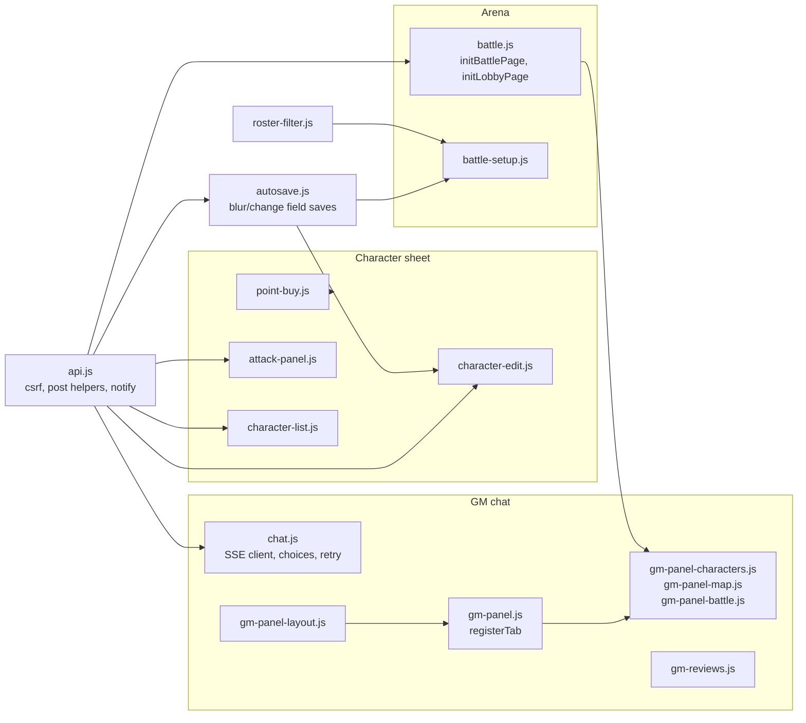

`battle.js` is loaded by both the arena page and the GM chat page: the chat's
Battle tab calls the same `initBattlePage(scope)` against its own container, and
`gm/views.py` imports `battle.views.arena_context` so both render the same
partials.

---

## 3. Request and auth flow

Middleware order matters and is fixed in `tarmar_studio/settings.py`:

1. `common.middleware.TrustedProxyClientIPMiddleware` — first, so everything
   downstream reading `REMOTE_ADDR` agrees on the client.
2. `SecurityMiddleware`
3. `WhiteNoiseMiddleware`
4. `SessionMiddleware` (database-backed; no `SESSION_ENGINE` is set anywhere, so
   Django's default applies)
5. `CommonMiddleware`
6. `CsrfViewMiddleware`
7. `common.middleware.GateRateLimitMiddleware`
8. `common.middleware.PublicPathPassphraseMiddleware`
9. `AuthenticationMiddleware`
10. `MessageMiddleware`
11. `XFrameOptionsMiddleware`

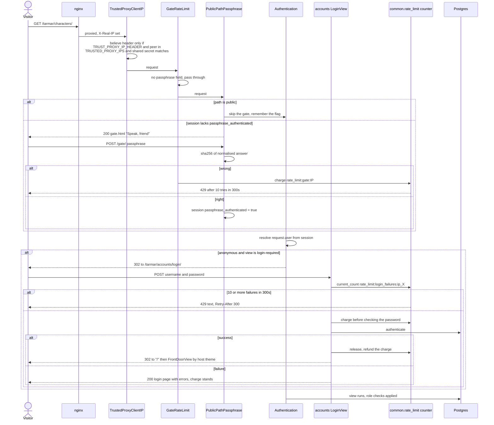

Role checks are applied in three shapes, all server-side:

- **Mixins** — `common/mixins.py` exports `ActivePageMixin`,
  `AdminOrDMRequiredMixin` (`test_func` returns `user.can_manage_users`) and
  `DMToolsAccessMixin`, which combines the two with `LoginRequiredMixin`. The
  DM tools all use it: `bestiary/views.py` (`CatalogView`, `BeastDetailView`,
  `GenerateBeastView`, `DeleteGeneratedBeastView`), `encounters/views.py`
  (`EncounterGeneratorView`), `ruins/views.py` (`GeneratorFormView`).
- **Per-object predicates** — `battle/access.py` (`readable_battles`,
  `can_control`, `decides_for`, `Actor.holds_seat`),
  `characters/models.py::characters_visible_to`, `parties/models.py::
  can_manage_party`, `common/helpers.py::is_owner_or_manager`.
- **Inline reads of the flags** — `reference/views.py` computes
  `is_dm = user.is_authenticated and (user.is_dm or user.is_role_admin)` at both
  the page and the search path, and gates on
  `path.startswith("dm-rules") or path in collect_dm_only_paths(REFERENCE_NAV)`.

Two rate limiters exist and are not the same thing.
`common/decorators.py::rate_limit` re-exports
`origami_common.decorators.rate_limit`; it keys on user or IP in Django's cache
(configured here as `DatabaseCache` on `tarmar_cache_table`) and answers 429
JSON. It guards the JSON endpoints — `gm_stream` at 30 per 60s, character import
at 10 per 60s, equipment edits, skill allocation and the rest. Login and the
gate instead use `common/rate_limit.py`, a fixed-window counter on the
`common.models.RateLimitCounter` table, because it must survive a cache flush
and be refundable: `accounts/views.py::LoginView.post` charges *before* checking
the password and calls `release()` on success.

---

## 4. The character generator

A character is one row, `characters.Character`, kept at db_table
`accounts_character` because it was moved out of `accounts` without a table
rename (see the comment in `characters/models.py`). Almost nothing is stored
twice: the six rolled attributes, a handful of roll strings and five JSON blobs
are the state, and everything a sheet displays is a derived property.

### Creation

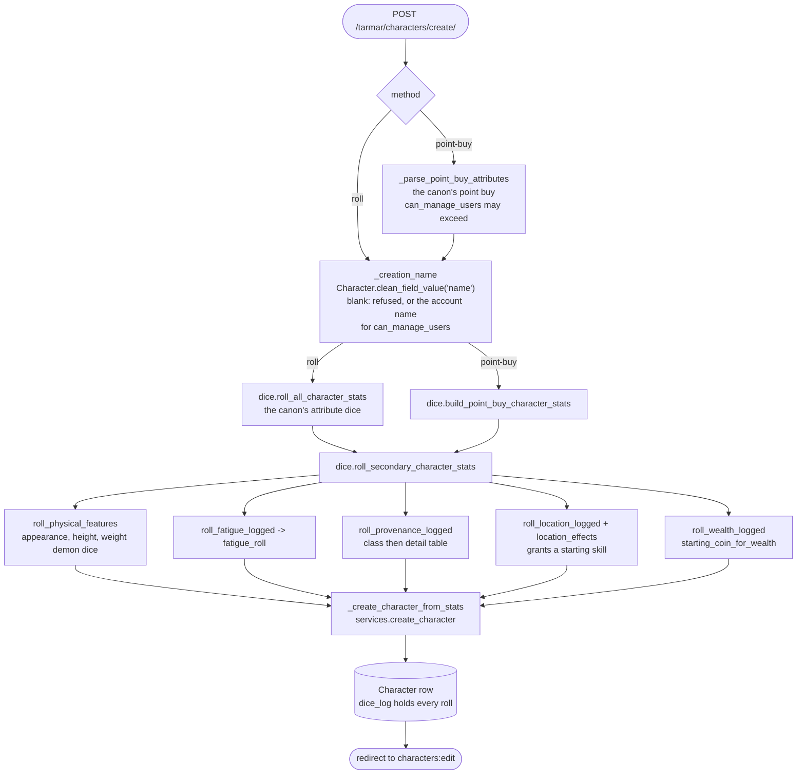

`static/js/point-buy.js` (`initPointBuy`, `tallyPointBuy`) only greys out the
submit button; the server re-parses every value. The name (issue #786) is
checked after the buy and before any dice, by the rule the sheet's rename and
the import use; a refused buy or name re-renders the page with the reason and
creates nothing. Every number the flow uses (the point buy's budget and
bounds, the attribute ceiling, the dice, the tables) lives once, in the loaded
canon's `character-rules.json`, read through `characters.rules.character_rules()`
(issue #59). The default canon's file states the public pages' numbers, which
the drift tests in `characters/tests/test_rules_consistency.py` and
`test_dice_fidelity.py` hold to the pages; `characters/tests/test_rules_seated.py`
seats invented rules to prove every caller reads them.

### The derived-stat pipeline

Nothing below is a column. Each arrow is a property on `Character` delegating to
a rules module.

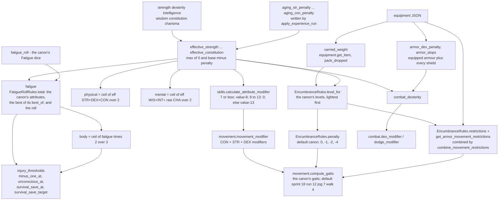

Two details the diagram flattens, both worth knowing before changing anything:

- `_sum_armor_field` counts armour only when the item is `equipped`, but counts
  every shield. `_sum_weapon_mod` counts **every** weapon in the inventory,
  which is why `Character.weapon_to_hit_mod` and friends are the *display* tiles
  only. `characters/attack.py::resolve` deliberately uses the selected item's
  own `to_hit_mod`/`damage_mod` instead; its module docstring calls the summed
  properties a pre-existing display bug.
- Four derived values are memoised on the instance and cleared in `save()`:
  `_CACHED_DERIVED = ("total_allocated_skill_points", "total_equipment_weight",
  "pack_weight", "carried_weight")`.

### Unplayed years, experience and skill points

An unplayed character buys its past in "runs" of years on a track. One run is
one entry in `experience_log`.

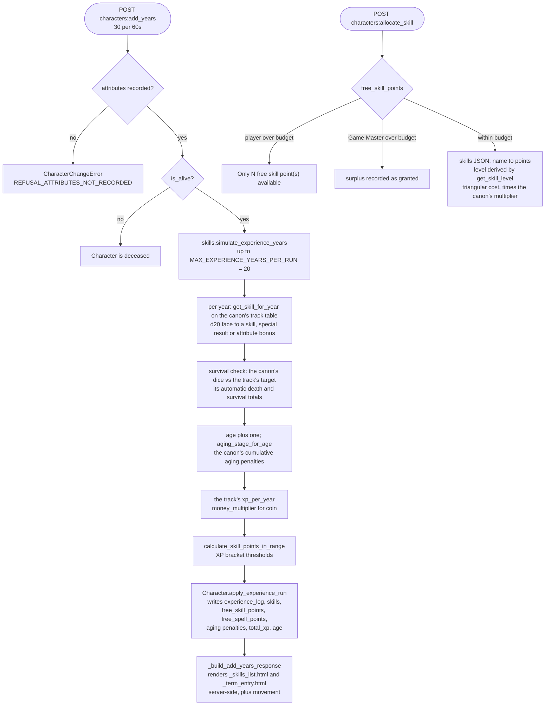

`skills` is a flat `{normalised_name: points}` map; a *level* is never stored —
`skills.get_skill_level(points, name)` derives it, and `skill_cost_multiplier`
multiplies the ladder by the canon's `skill_cost.multipliers` (Arcane's, on the
public pages). Every number in this flow (the tracks, the ladder, the costs, the
survival roll, the aging table, the modifiers) lives once, in the loaded canon's
`skill-rules.json`, read through `characters.skill_rules.skill_rules()` (issue
#70); the procedures stay in `characters/skills.py`. The default canon's file
states the public pages' numbers, which the drift tests in
`characters/tests/test_rules_consistency.py` and `test_dice_fidelity.py` hold to
the pages; `characters/tests/test_skill_rules_seated.py` seats invented rules to
prove every caller reads them, and the e2e specs read them through the Django
shell (`e2e/skill-rules.js`) rather than typing a number.

`is_played` is a separate thing from having years: it flips only through
`Character.mark_played_by(user)`, which no-ops unless the actor owns the
character, so a DM editing someone else's sheet does not mark it played.

Every mutation goes through `characters/services.py`, not through the ORM
directly. `services.changing(pk, actor, authorize=...)` yields a `Change` under a
row lock and returns a `ChangeResult`; the write helpers (`record_attributes`,
`roll_attributes`, `roll_fatigue`, `roll_literacy`, `rule_literacy`,
`add_experience_years`, `allocate_skill_points`, `add_equipment`, `rename`,
`revive`, `set_background`, `update_field`, `create_character`) are the
single API shared
by the HTTP views and the GM's executor. Rule refusals raise
`CharacterChangeError`.

### Equipment and attacks

The catalog is the loaded canon's `equipment.json`, read through
`characters.equipment_rules.equipment_catalog()` the first time a reader asks
(issue #75), and answered for the rest of the app by `characters/equipment.py`
— there is no table. The numbers encumbrance and movement read (the levels,
the armour restriction codes, the gaits and their base distances), the Missile
classes (which Archery covers and the battle seats as missile weapons) and the
bounds on the dodge the attack panel takes are
the loaded canon's `equipment-rules.json`, read through
`characters.equipment_rules.equipment_rules()`; the code reads a level or a
gait by its place, never its name. The default canon's two files state the
public pages' items and numbers, which the drift tests in
`characters/tests/test_rules_consistency.py` and `test_dice_fidelity.py` hold
to the pages; `characters/tests/test_catalog_follows_the_canon.py` and
`test_equipment_rules_follow_the_canon.py` seat an invented catalog and
invented rules to prove every caller reads them, and the e2e specs read them
through the Django shell (`e2e/equipment-rules.js`) rather than typing an item
or a number.
The six equipment endpoints (`equipment_add`, `equipment_update`,
`equipment_remove`, `equipment_bulk_remove`, `equipment_toggle_pack`, plus the
read-only `equipment_catalog`) all funnel through `_change_equipment` and answer
with `_get_equipment_response`, which recomputes the whole derived block —
weights, encumbrance, movement, armour, and the weapon list for the attack
panel — in one response.

Attack resolution is `characters/attack.py::resolve`, backed by
`characters/combat.py` (`MATRIX`, `target_number`, `resolve_attack`,
`damage_after_armour`, `fumble_result`, re-exported from `tarmar_rules`). The
endpoint is `characters:attack`, which appends `attack.log_entry(...)` to
`combat_log` (capped at `MAX_COMBAT_LOG_ENTRIES`).
`static/js/attack-panel.js` reads every number off the response and computes
nothing.

### Import and export

`character_export/export_utils.py::EXPORTABLE_FIELDS` is the round-trippable
field set, and both directions use it: `generate_character_json` emits
`{"_format", "_version", "data"}`, and `characters/import_service.py::
validate_import_payload` projects an uploaded file onto the same list, dropping
extras and re-running `Character.clean_field_value` so an import cannot grant
what the edit endpoint would refuse. `user`, `created_at`, `is_public`, the soft-
delete pair, `history`, `combat_log` and `import_notice` are deliberately
excluded.

Who imports decides what is kept (issue #744). The import view hands the
validated file to `held_to_player`, the one place the rule lives. A Game
Master's import (`can_manage_users`) is verbatim. Every player's import is a
new character, whatever file it came from, since a file the site wrote is
still someone's character as it once stood: it keeps only
`PLAYER_KEPT_FIELDS` (the exported fields `services.FIELD_RULES` lets a player
set), less `PLAYER_IMPORT_NEVER_KEPT` (skills, life and death, played, the
Mana Pool, spells and coin), and every other exportable field arrives at a
fresh character's value (`fresh_player_fields`: nothing rolled, the Origin's
granted skill, the background unrolled). Nothing is bought, since the wealth
is unrolled; each thing carried is named in `left_out`. The file is validated
as it stands first, so an impossible value is refused rather than dropped.
What was dropped is stored on `Character.import_notice`, shown on the sheet
until dismissed, and returned under `import_notice` in the import response.

### Incomplete characters

Since issue #571 the six attributes and `fatigue_roll` are nullable, and
completeness is derived, never stored:

- `Character.missing_parts` returns `NEEDS_ATTRIBUTES` and/or
  `NEEDS_FATIGUE_ROLL`; `Character.is_complete` is `not missing_parts`.
- `Character.pools()` raises `ValueError` naming what is missing; `fatigue`,
  `body`, `physical`, `mental`, `weight_lbs` and `injury_thresholds` return
  `None` rather than inventing a number.
- `CharacterQuerySet.playable()` is the one filter for "may be used", and every
  consumer calls it: `battle/services.py`, `parties/models.py::
  addable_characters`, `gm/views.py`, `gm/fight.py`, `gm/roster.py`,
  `gm/turn_engine/state.py`.
- The three exports refuse with HTTP 409 via
  `character_export/views.py::_incomplete_refusal`.
- The UI marker is one partial, `characters/templates/characters/
  _incomplete_marks.html`, reused by the character list, the sheet and the GM's
  Characters pane. `Character.status` reports `"Incomplete"`.

### Auto-save

`static/js/autosave.js` is edge-triggered, not debounced — there is no
`setTimeout` in `character-edit.js`. Text and number inputs save on `blur` and
only when the value differs from the recorded original; selects and checkboxes
save on `change`; Enter commits by blurring (`api.js::bindCommitKeys`, which
skips textareas). The sheet's whole configuration arrives as one
`|json_script` block, `#character-edit-config`, built by
`CharacterEditView.get_context_data`; the attack panel has its own,
`#attack-panel-config`.

### Character models

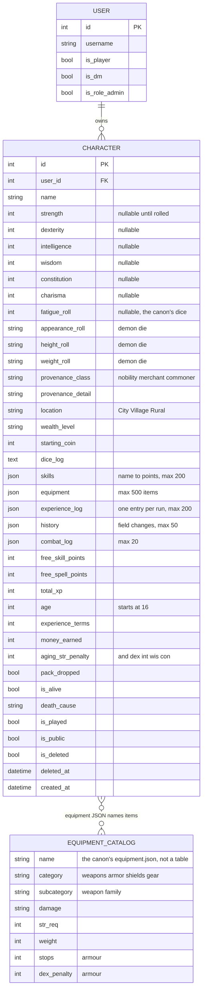

---

## 5. The battle engine

The arena is a hex board with a six-phase turn. The rules live in the pinned
`tarmar_engine` package; `battle/` owns persistence, permissions, seating and
the browser contract. A second rules profile, classic *Melee*, plugs into the
same seam.

### Setup

Since issues #270 and #271 setup is its own page backed by a server-side
`BattleDraft` row, in three stages (`battle/templates/battle/battle_setup.html`:
`stage-terms`, `stage-muster`, `stage-march`).

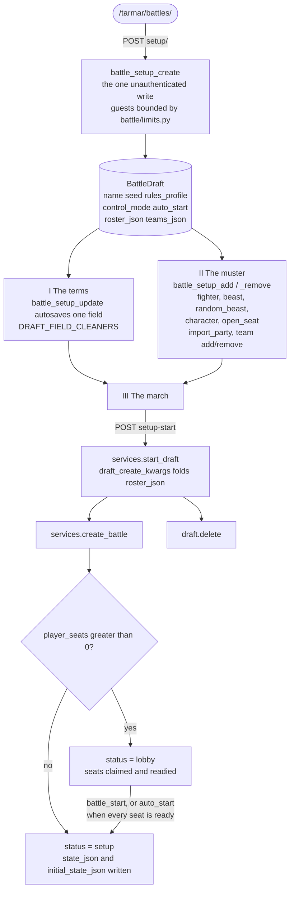

Saved characters are offered only to signed-in users; a guest asking for
`kind: "character"` is refused 403 with a note. Entries that have become
unusable (a deleted or now-incomplete character) show as `stale` and block the
march until struck.

### Rules profiles

`battle/persistence.py` defines `PROFILE_CHOICES = [(TARMAR_PROFILE, "Tarmar"),
(CLASSIC_PROFILE, "Classic Melee")]` and the load/dump pair;
`battle/profiles.py` defines the seam itself — an abstract `BattleProfile` with
`TarmarProfile` and `ClassicProfile`, looked up by
`profiles.for_battle(battle)`. The profile decides the roller, the turn runner,
how a combatant is identified, how events are sequenced, what "still standing"
means, which view model is built (pointy-top vs flat-top hexes) and how a
caster's hand is read. Everything else in `battle/` is profile-neutral.

### Seats and control modes

Issue #308 replaced an arrangement with a setting. `battle/control.py`:

- `AUTOMATIC = "automatic"` — the AI decides.
- `MANUAL = "manual"` — the combatant's owner decides.
- `INHERIT = ""` — combatant only, follow the battle.

`Battle.control_mode` is the default; `BattleCombatant.control_mode` overrides
it; `control.effective_mode(battle, combatant)` is the one resolution. Who may
act is `battle/access.py::decides_for`: a seat that someone has actually taken
(`player_id` or `guest_key` set) belongs to its holder alone; everything else
belongs to whoever can control the battle (`is_dm` or the owner). Claiming a
seat sets it to `MANUAL`; releasing resets it to `INHERIT`. Hiding buttons is
never the enforcement — `battle_control`, `combatant_control` and
`record_player_action` each re-check.

### A Game Master's rulings on a battle

Two rulings let a Game Master lift what players are held to, each stored on
the battle and changed only through the battle's GM controls by the fight's
runner while a Game Master (`battle/services.py::runs_the_seats`):
hand-to-hand by agreement (`Battle.hth_agreement_json`, `battle/agreement.py`,
#867) and a figure's lifted magic bounds (`Battle.magic_bounds_lifted_json`,
`battle/magic_bounds.py`, #37). The second offers only the bounds the loaded
canon imposes (Channel, the push cap, the counter's commitment bounds) and
records who lifted each and when; the Tarmar profile writes it onto each
figure's `lifted_magic_bounds` every turn (tarmar-engine v0.9.17), so the
engine's menu offers that figure the wider amounts and a cast or counter past
a lifted bound is narrated as such. Every change writes a log line; the battle
payload carries both records and their panels (`rulings`, `rulings_html`),
which `battle.js` repaints. Their words (headings, buttons, log lines,
refusals) are configuration: `config/battle-rulings.toml`, read and checked at
startup by `battle/wording.py::load_rulings_wording` into
`settings.BATTLE_RULINGS_WORDING` (`BATTLE_RULINGS_WORDING_FILE` names another
file).

The rest of the battle app's refusals -- the setup, muster, lobby, seat and
choice services, the views' answers to who may act and to malformed requests,
the control modes, and the notes a guest reads beside a control -- are
configuration the same way: `config/battle-refusals.toml`, one table per
module, read by `battle/refusal_words.py` into `settings.BATTLE_REFUSAL_WORDS`
(issues #97, #86). The Games Master app's refusals (its views, hand edits,
fights, Luck, withdrawals, the plan policy and the executor) are
`config/gm-refusals.toml`, read by `gm/refusal_words.py` into
`settings.GM_REFUSAL_WORDS`. All three files go through one loader,
`common/wording.py::load_wording`, which refuses a missing or unknown key, a
blank value or a `{name}` a sentence may not use at startup. Tests run under
`common.wording.fixed_wording`, never the shipped sentences.

### A battle's life

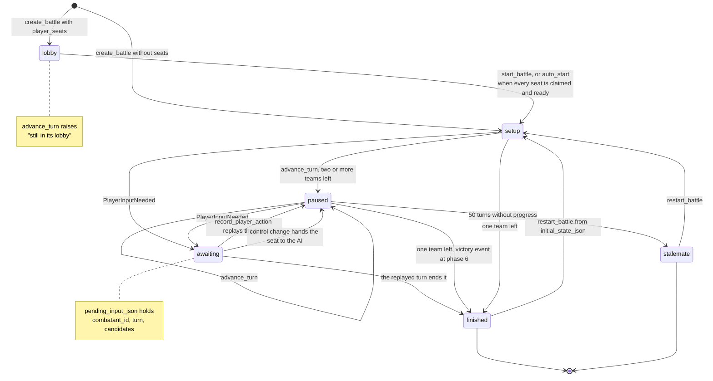

Soft delete is orthogonal: `battle_delete` / `battle_restore` toggle
`is_deleted` without touching the status, and the event log survives.

### One turn, one attack

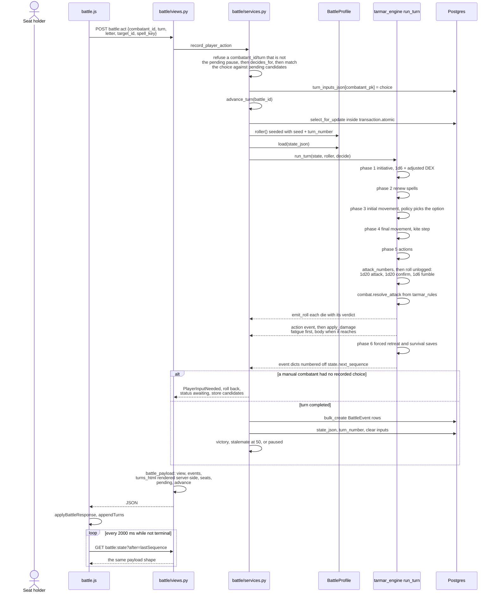

The arena polls; it does not stream. `POLL_INTERVAL_MS = 2000` in
`static/js/battle.js`, and `TERMINAL_STATUSES = ['finished','stalemate']` stops
it. SSE in this repo belongs to the GM chat alone. New log markup is rendered
server-side by `views.rendered_turns` into `battle/_turn_group.html` and
inserted by `appendTurns` — the browser does not build event HTML.

A human's choice does not bypass the AI: `services._human_decider` lets the
policy build the menu and then replaces the chosen option, rewriting the
rationale as "chosen by <owner>". A choice that is no longer on the menu pauses
again as `stale`.

### Spectating

There is no spectator view, URL or template. `BattleDetailView` sets
`context["is_spectator"]` when the viewer cannot control and holds no seat, and
the page renders the same arena, roster and full event log — a finished battle
replays for free because every line is a `BattleEvent` row. What a spectator
does not get: `pending_payload` returns `candidates: []` and no caster hand,
`advance_control` returns `None`, and `detail_visible_ids` withholds attribute
panels for combatants they do not own. Reading a battle is open to every
signed-in user; an anonymous viewer is redirected to login rather than 404 when
the battle holds a non-public character.

---

## 6. The Games Master

The GM is the largest subsystem. Its governing idea, stated in
`gm/engine.py::SECTION_RECORDS` and enforced by the engine: **the model narrates
and the code owns every number**. A turn is three steps — plan, run, narrate —
and only the middle one may change a record.

### One turn

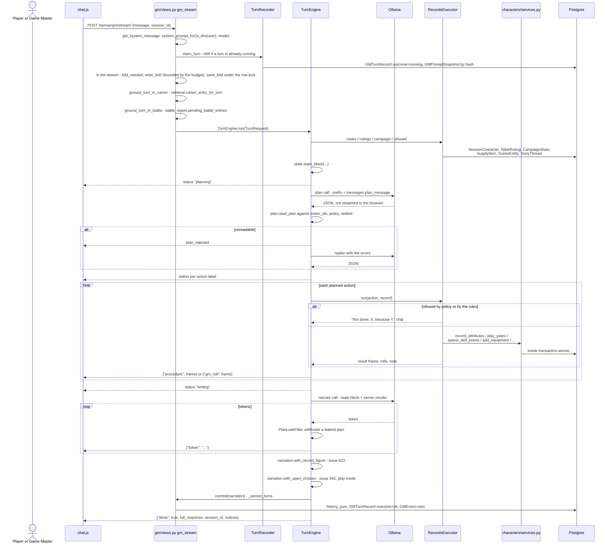

Checkable anchors: the view is `gm/views.py::gm_stream` then `_plan_turn`; the
state machine is `gm/turn_engine/engine.py::TurnEngine` with
`TurnState = GROUNDING, PLANNING, EXECUTING, NARRATING, COMMITTING, DONE,
FAILED`; the model port is `gm/turn_engine/model.py::OllamaModel`.

### Actions, not markers

The older `[[procedure: ...]]` marker loop is gone — deleted in commit
`8acb461` ("Delete the marker turn loop now that the plan engine runs every
turn", issue #590). The model now answers the planning call with JSON, read by
`gm/turn_engine/plan.py::read_plan` and executed by
`gm/turn_engine/executor.py::RecordsExecutor.run`. The word "procedure" survives
as the name of the chip frame a record-changing action produces
(`ActionResult.procedure`, `GMTurnRecord.procedures`, the SSE key `procedure`).

The 24 action names live once, in `gm/turn_engine/policy.py::ACTION_NAMES`, and
are declared to the model by `gm/engine.py::section_plan_schema`:

| Group | Actions |
| --- | --- |
| Character records | `record_attributes`, `roll_attributes`, `roll_fatigue`, `roll_literacy`, `rule_literacy`, `play_years`, `spend_skill_points`, `add_equipment`, `rename_character`, `set_background`, `revive_character`, `remove_character` |
| Campaign records | `move_party`, `advance_time`, `adjust_supplies`, `record_npc`, `record_object`, `open_thread`, `resolve_thread` |
| Table rulings | `record_house_rule`, `retire_house_rule` |
| Other | `roll`, `rules_lookup`, `ask_gm` |

`GAME_MASTER_ONLY_ACTIONS` is `{revive_character, remove_character,
rule_literacy}` plus the two house-rule actions. Refusals come in three layers, which is worth keeping
straight when debugging:

1. **Schema errors** — not a refusal. `read_plan` returns errors, the engine
   emits `PLAN_REJECTED`, sends `replan_message(errors)` and re-reads once;
   a second failure sets `plan_unreadable`.
2. **Policy refusals** — `TurnPolicy.refusal_reason` names the reason, a
   `REASON_*` key of the `[policy]` table in `config/gm-refusals.toml`
   (`game_master_only`, `house_rule`, `player_stated_scores`,
   `aide_unasked_roll` and the rest), and `refusal_for` gives its configured
   words. The action is marked refused but left in order; the executor raises
   `_Refused` and produces `"Not done: X, because Y."`, recording the key in
   the action's frame as `refusal_reason`. A `character_id` outside the roster
   is refused too, with no policy reason.
3. **Settled refusals** (issues #614, #97) — `state.settled_refusals` scans the
   last `REFUSAL_LOOKBACK = 80` action events and holds those whose frame's
   `refusal_reason` is in `policy.SETTLED_REASONS`, by key, never by the
   sentence, so two reasons given one sentence stay apart and an edited
   sentence keeps its stored refusals settled; asking again becomes a *schema error*
   via `policy.already_refused_error`, which forces a replan instead of a second
   identical refusal.

Rules refusals raised at run time (`CharacterChangeError`, `ValidationError`,
`Character.DoesNotExist`) are caught in `RecordsExecutor.run` and given the same
shape.

### The state block

Built fresh from the rows every turn by
`gm/turn_engine/state.py::state_block(policy, lines, rulings, campaign,
refused)` and placed at the head of the last message of *both* model calls. It
is never saved into history. Sections, each omitted when empty:

1. `policy.speaker_line` — whether this message is from the Game Master.
2. `Session characters:` — one `RosterLine` per character, carrying
   `key_figures`: the six attributes or "not recorded", Fatigue and Body or what
   they still wait for, age, years of experience, XP and level, free skill
   points, alive or dead, and `missing_parts`.
3. `Rulings at this table:` — active `TableRuling` lines.
4. `Where the party is:` — `CampaignState.lines`.
5. `Carried between them:` — `SupplyItem` lines.
6. `People met:` and `Things in play:` — `SceneEntity` lines by kind.
7. `Still open:` — unresolved `StoryThread` lines.
8. `Already refused in this session, do not plan again:` — up to
   `MAX_REFUSALS_LISTED = 5`.

Character sheets and the old ledger block are **no longer sent to the model at
all**: `gm/turn_engine/history.py::NOT_FOR_THE_MODEL` filters out `sheet`,
`ledger`, `roll`, `procedure` and `interrupted` entries. Those figures reach the
model only through the roster lines.

### Campaign state (issue #579)

`CampaignState` is one-to-one with the session (place, `place_key`, day, time of
day); `SupplyItem`, `SceneEntity` and `StoryThread` hang off it. Only
`RecordsExecutor` writes them — `_campaign_state`, `_supplies`, `_scene_entity`,
`_resolve_thread` — each inside `transaction.atomic()` with `select_for_update()`
for updates. Three readers: `state.CampaignBlock.of(session)` for the prompt,
`gm/views.py::_campaign_panel_context` for the Campaign tab, and
`_party_map_payload` → `gm/maps.py::party_place` for the map, which beats
guessing a place out of the narration.

### How the prompt is assembled

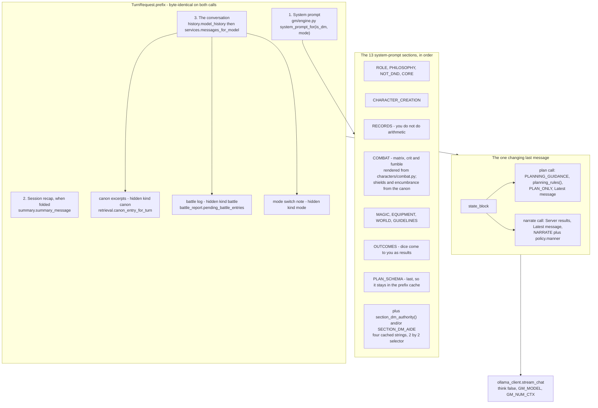

The prompt is one of four cached builders, each assembled the first time a
turn asks and the same string for the life of the process, never per request:
`system_prompt()`, `aide_system_prompt()`, `dm_play_system_prompt()`,
`dm_system_prompt()`, selected by
`system_prompts_by_authority_and_mode()[(is_game_master, mode)]`. They are
built on first use rather than at import because five of the sections and
the authority addendum state numbers from the loaded canon's rules files
(issues #68, #70), which no module may read while it imports. The schema
section is last on purpose so the growing prefix stays cacheable on the Ollama
side.

Each sentence that states a number a canon rules file holds is built from the
rules object that holds it, by a cached builder registered with
`derived_from_rules` (issue #68):

| Section builder | Built from |
|---|---|
| `section_core()` | `skill_rules()`: the attribute and skill checks' dice and naturals, the modifier table. `character_rules()`: the attribute dice and point buy, the height and weight bands, the Fatigue sum (`FatigueRollRules.formula`, the one rendering the sheet uses too) |
| `section_character_creation()` | `character_rules()`: the attribute, Fatigue and literacy dice, the point buy, the provenance bands, the starting age. `skill_rules()`: each track's label and XP a year, whether weapon skills lead most tracks, the experience ladder |
| `section_combat()` | `skill_rules()`: the skill and attribute checks' dice. `equipment_catalog()`: each shield's Target Number bonus. `equipment_rules()`: every encumbrance level, its band of STR, its penalty and the gaits it forbids or caps |
| `section_equipment()` | `equipment_catalog()`: every weapon (damage, STR, class, notes), armour (stops, DEX, tier) and shield; `equipment_rules()`: the gaits each armour's restriction code forbids |
| `section_plan_schema()` | `skill_rules()`: the tracks it lists and the first one, named in two examples, and the attribute check's dice. `character_rules()`: the attribute, Fatigue and literacy dice |
| `section_dm_authority()` | `character_rules()`: the attribute dice and the point buy's total and top |

The plan call's rules line (`gm.turn_engine.messages.planning_rules()`, cached
and registered the same way) states the canon's attribute and Fatigue dice.
One sentence states canon content by hand: `TRACK_YIELDS_SENTENCE`, what the
Magic, Underworld, Craft and Laborer tracks yield. No rules file says what a
track is known for, and the behaviour check's scenarios assume these tracks;
it is to be revisited if a canon changes its tracks. Left as code, among them
(`gm/engine.py`'s module docstring lists them all): the engine's own numbers for
stages 6 and 7 (initiative, crits and fumbles, the matrix, the survival save,
the injury bands, the casting dice, the megahex, hand-to-hand's 4d6, the
defender dodge), Movement Speeds' base distances (the canon holds them, but not
each gait's prose), and the plan format's illustrative values.

### Canon retrieval (rules lookup, issues #605 and #333)

Two distinct things share the name "rules":

- **`gm/rules_lookup.py`** answers a *rules number* from code, not from memory:
  `RULES = {"survival": ..., "survival_targets": ..., "combat": ...}`, every
  sentence built from the loaded canon's rules files (`characters/skill_rules.py`,
  `characters/rules.py`) and `characters/combat.py::MATRIX`. The `rules_lookup` action calls `look_up`;
  an unknown subject raises `UnknownRule` listing what exists and reminding the
  model that a character's figure is a record, not a rule.
- **`gm/retrieval.py`** is the semantic index over `reference/content/`.
  `manage.py build_gm_index` chunks the markdown (300 to 600 tokens), embeds it
  with `nomic-embed-text` and writes `var/gm-index.json` via a `.partial` file
  and an atomic replace. At turn time `canon_entry_for_turn` embeds the query,
  retrieves top-k within a token budget, skips chunks already shown, and files
  the result as a hidden `kind: "canon"` history entry with a `user` role — so
  it persists and the prompt prefix keeps its cache across turns. A missing
  index or a failed embedding logs and returns nothing; the turn continues.

### The session fold

`gm/summary.py` keeps a long session inside the context window.
`should_fold(history, num_ctx)` is true when a fold point exists and the history
exceeds `FOLD_AT_FRACTION = 0.6` of the usable budget
(`num_ctx - REPLY_RESERVE_TOKENS`). `fold_point` keeps the last
`KEEP_RECENT_ENTRIES = 24` entries verbatim and asks the model for at most 200
words of plain prose about the story — no figures. The result lands in
`GMSession.summary` with `summary_covers` counting the entries it replaces, and
`folded_history` splices it in as a marked (`RECAP_KIND`) user message where the
folded entries were. It is deliberately not a system message: a stored history
holds none, so the recap would lead the list and `gm_stream`'s guard would read
it as the GM's prompt already being in place (issue #631).

### Turn records and the resume path (issues #389 and #515)

Every turn leaves a `GMTurnRecord` beside the history, including turns that
failed, ran out of budget, were refused or whose page went away — none of which
write history. The system prompt is stored once per distinct text in
`GMPromptSnapshot`, keyed by hash. Within a turn, each engine event becomes an
append-only `GMEvent` row (`save()` raises `ValueError("GM events are
append-only")` on update).

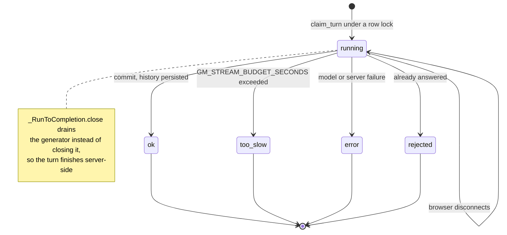

The client half: a lost view calls `awaitRunningTurn(turnId)` in `chat.js`,
polling `gm:turn` (`turns/<int:turn_id>/`) for `running | finished | failed`.
`expire_stale_running_turns()` clears anything running longer than
`GM_RECAP_BUDGET_SECONDS + GM_STREAM_BUDGET_SECONDS + RUNNING_TURN_GRACE_SECONDS`
(the grace is 180 s; the recap budget counts because a continued session's
first turn spends it before its own, issue #936). A genuine retry
(`data["retry"]` plus `resumes_interrupted_turn`) sets `TurnRequest.plan =
False` and feeds the already-filed results back as `known_results`, so the turn
is **narrated, not re-run** — nothing is applied twice.

### Streaming

`gm:stream` answers a `StreamingHttpResponse` of `text/event-stream` with
`X-Accel-Buffering: no` and an `X-GM-Turn` header naming the turn. There are no
SSE `event:` names — every frame is an unnamed `data:` line and `chat.js`
dispatches on the JSON keys: `token`, `status` (with `elapsed`, and `busy` for
a turn waiting behind others), `procedure`, `gm_roll`, `done`, `error`. Keepalive is two layers: `KeepAliveTokens` yields a `None` every
`GM_STREAM_KEEPALIVE_SECONDS = 10` of model silence, which becomes a `WAITING`
event, and a literal `": keep-alive"` comment goes out ahead of it so a proxy
does not close an idle connection.
Every model call a turn makes is given the turn's deadline as `stop_at`, which
hangs up its connection there even while a read waits on a stream that stalled,
and `KeepAliveTokens.close()` hangs up a call the turn has given up on (issues
#887, #904). The hang-up needs the response's socket, which httpx exposes only
once the headers arrive, and Ollama sends its headers with the first token: a
hang-up asked for before then runs when they arrive. So during prefill, or
while the call is queued behind another turn, the model is held until the first
token or the turn's deadline, whichever comes first; the read timeout is held to
that deadline.

#### A turn waiting for the model

Ollama on the production host answers one request at a time
(`OLLAMA_NUM_PARALLEL=1`), so a turn sent while other turns are being answered
waits, silent, until its turn comes (issue #64). The app cannot see Ollama's
line; its own view of it is `turns_ahead_of(record_id)` in `gm/turn_record.py`:
the turns and fights claimed before this one and still running, every player's,
stale ones left out. The engine is handed a `ModelQueueWait`
(`gm/turn_engine/model_queue.py`); at each `WAITING` silence before a call's
first token it asks that count, and while it is above zero the time is counted
as waiting and the `waiting` frame carries `busy`, the whole line the page shows
instead of "The Game Master is working": `GM_QUEUE_STATUS_ONE_AHEAD` or
`GM_QUEUE_STATUS_MANY_AHEAD`. A silence after the first token is the model
working and is never counted. The count is per turn while Ollama's line is per
call (a turn whose call is being answered is still counted), so the wording
says how many turns started earlier are still running, not a place in the
line. The fold's recap call runs on the turn's clock and is not streamed, so
it has no first token: the whole call is looked at the same way, and its wait
counts toward the turn's.

A turn that runs out of budget is told `GM_STREAM_QUEUED_TOO_LONG_MESSAGE`,
which names the queue and says not to resend straight away, when it was still
waiting behind other turns as the budget ran out or had spent at least half the
budget (`QUEUE_BLAMED_SHARE`) waiting; otherwise `GM_STREAM_TOO_SLOW_MESSAGE`.
`/fight`'s foe call is one blocking request on a 50 s budget with no
keep-alives to look at the line from, so its cut (`GM_FIGHT_TOO_SLOW_MESSAGE`)
says the Game Master is often busy with other tables then and asks for a minute
before trying again, rather than inviting a retry at once.

All five are settings with their defaults in `settings.py`, overridable from the
environment (`common/message_templates.py`). Each is a `str.format` template
filled in with whole numbers, even one with no fields, so a literal brace is
written doubled; a template naming a field it may not use, or one a trial
fill-in refuses (a bad format spec or conversion), stops startup.

Queue time counts against `GM_STREAM_BUDGET_SECONDS`. Leaving it out was
weighed and refused. Each call is handed the turn's deadline as `stop_at` when
it is sent, and the port hangs up there (#904), so a clock that paused while
queued would need a deadline that moves under a call in flight. From inside the
call a queued request and a model loading or reading its prompt look the same
(no headers until the first token), so a budget that skipped the queue would in
practice have to skip everything before the first token, leaving a model that
never answers unbounded. And `expire_stale_running_turns` takes a turn running
longer than the budgets plus a grace to have died, opening its session to a new
message; a turn allowed unbounded queue time could be declared dead while
alive.

The calls made outside a turn's clock carry deadlines of their own (issue
#936). A continued session's catch-up recap, written before the turn starts,
is given `GM_RECAP_BUDGET_SECONDS` (default 300) as `stop_at`; a recap cut
there is carried as the last session's fold recap, labelled as one, as when the
model fails; the view hands its worker a hang-up and waits at most
`CATCH_UP_GRACE_SECONDS` (1 s) past the deadline for it to hand back what it
has. A page that leaves does not end the call (`_RunToCompletion` drains the
stream), so the deadline is what bounds it.
`/fight`'s foe calls are non-streaming `chat` calls, which take `stop_at` too:
Ollama sends a non-streaming answer's headers only once the answer is written,
so the read timeout held to the time left ends the wait, and the body is read
over a streamed response that is hung up at the deadline. `chat_structured`
gives its call and its no-`format` fallback one deadline, and `/fight` gives
all of its foe calls, the second ask included, one deadline of
`GM_FIGHT_BUDGET_SECONDS` (default 50); a cut is answered with a 504 in words
and the turn record marked too slow. That budget is below nginx's 60 s
`proxy_read_timeout`; raise the two together. `/fight` is a plain JSON POST
that sends nothing until it answers, so a longer budget alone lets nginx cut
the request with an HTML 504 while the server still holds the model;
`gm-panel-battle.js` reports such a non-JSON answer with its status.
Connect, write and pool timeouts (10 s each) are not held to a deadline, so a
call can outlive its `stop_at` by about 10 s before any bytes arrive.

### The side panel

`static/js/gm-panel.js` is a registry: `window.gmPanel.registerTab(name, button,
container)`, with `discoverTabs` picking up every `[data-panel-tab]`. Four tabs
are declared in `gm/templates/gm/chat.html`:

| Tab | Partial | Driver |
| --- | --- | --- |
| Characters | `_panel_characters.html` | `gm-panel-characters.js` — full sheets of the attached characters |
| Campaign | `_panel_campaign.html` | refetched from `gm:campaign_panel` |
| Map | `_panel_map.html` | `gm-panel-map.js`, place names from `gm/maps.py` |
| Battle | `_panel_battle.html` | `gm-panel-battle.js` + `battle.js`, a real battle via `/fight` |

`gm-panel-layout.js` takes over the display when loaded: panes stack, collapse,
resize and pop out.

While a turn runs, `gm-panel-characters.js` refetches the Characters and Campaign
tabs whole. `gm-panel-drafts.js` carries what the reader has open or typed in
them through each refetch, by each form's `data-draft-key`, and the keyboard focus
by each control's `data-focus-key` (issue #16).

### Narration guarantees

Both are applied server-side in `TurnEngine.run`, after narration and before the
text is committed — #622 first, so the answer and the record it comes from stay
together.

- **Issue #342, the open-choices line.**
  `narration.with_open_choices(text)` appends "You may also describe any other
  action — these choices are not the only ones." when three checks pass: the
  text is non-empty, `offers_a_menu` finds at least two numbered items, and
  `_ALREADY_SAID` does not already match. It is skipped in aide mode. The client
  half turns that trailing run of numbered lines into buttons with
  "Something else…" last (`parseChoicePrompt`, `offerChoices` in `chat.js`).
- **Issue #622, the record figure line.** `figures_raised(message, actions)`
  decides which topics the turn is about — skill points, XP, level, years of
  experience, age, Fatigue, Body — from the question's wording or from a
  `spend_skill_points` action having been planned.
  `with_record_figure(text, topics, lines, message)` then appends at most one
  line, `"<name>'s record: <phrase>."`, taking the value straight off
  `state.ledger_figures(character)`. It stays silent when the message does not
  identify exactly one character, when the topic has no figure, or when the text
  already states the number. Since issue #727 "already states" means the number
  stands within a few words of the topic's own wording, in the same sentence,
  and is not signed: the digit matched anywhere used to count, so "+1 to her
  attacks" passed for a balance of one free skill point and the line never
  fired.
- Related: **issue #603**, `PlanLeakFilter` withholds a plan that leaks into the
  narration stream; `TurnEngine._leaked_plan` re-reads it, runs it once, and
  narrates again.

### The ledger

Since issue #571 `gm/ledger.py` records nothing — it is a read-only snapshot of
a `characters.Character` row for the Characters pane. `draft_character(values)`
rehydrates an *unsaved* `Character` so every derived figure comes from the
model's own properties, and `SkillPointAccount` breaks the budget into
experience XP, track grants, spent, remaining and points granted by a Game
Master.

### Reviews

A Game Master presses **Send to Claude** or types `/review <what to look at>`.
`gm_review_create` freezes the whole session with
`gm/transcript.py::transcript_payload` into a `GMReviewRequest.snapshot`. The
agent at `scripts/llm-host/tarmar-gm-review.sh` polls every minute, claims the
row over ssh (`manage.py gm_review claim`), exports `origin/main` beside the
frozen session and runs the Claude CLI locked down —
`scripts/llm-host/gm-review-settings.json` allows `Read(./**)` and denies
`Bash`, `Write`, `Edit`, `WebFetch`, `WebSearch`, `Agent` and every credential
path — then posts findings back. `GMReviewRequest.claim` is an atomic
`.update()` returning `updated == 1`, so two runners cannot claim the same row.
Findings render at `gm:review`; `gm-reviews.js` polls statuses every 15s.

### The CLI

`cli/tarmar.py` is an argparse front door (`play`, `simulate`). `cli/gm.py` runs
**without Django** and shares exact symbols with the web GM: the prompt
(`gm.engine.system_prompt_for`, `DEFAULT_RULES_DIR`, `roll_dice`), the fixed
wordings (`gm.messages`), the env config (`gm.model_config.GMModelConfig`,
`GMRetrievalConfig`), the same `var/gm-index.json`
(`gm.retrieval.canon_entry_for_turn`) and the character schema
(`gm.character_schema`). `TARMAR_GM_DM` and `TARMAR_GM_MODE` stand in for the
account role and the session mode. What it does **not** share: the turn engine.
The CLI is one model call per turn — no plan, no executor, no records, no state
block, no fold, no reviews.

### GM models

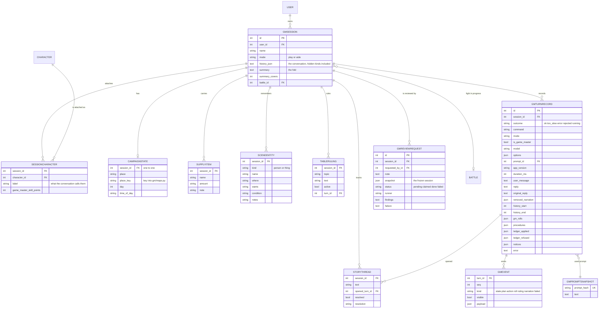

---

## 7. Data model overview

Across apps, at the level of models and the relations that matter. Field lists
are in sections 4 and 6; this is the shape.

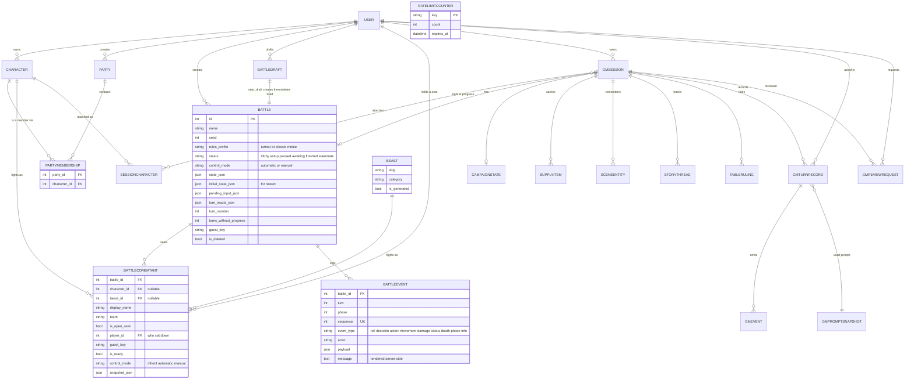

Four things have no models at all and are worth naming so nobody looks for
tables: the equipment catalog (the loaded canon's `equipment.json`, read when
asked), the rules wiki (markdown under `reference/content/` plus
`reference/nav.py`), the generator tables — `ruins/tables.py` and
`ruins/hooks.py` parse the loaded canon's `gm-tools/*.md` at load while
`encounters/generation.py` holds its d20 and d10 tables in Python, keyed to
bestiary slugs — and the canon index (`var/gm-index.json`).

---

## 8. Testing and quality gates

`ci.yml` runs where the repository variable `CI_RUNNER` says (#964): unset,
on GitHub's `ubuntu-latest`; `datahorde`, on a self-hosted runner in a
container on datahorde. The Mac Studio runner (`scripts/ci-runner/`, #576) no
longer receives jobs.
Independently of it, the check that stands between a merge and production runs
locally: `./run gate`.

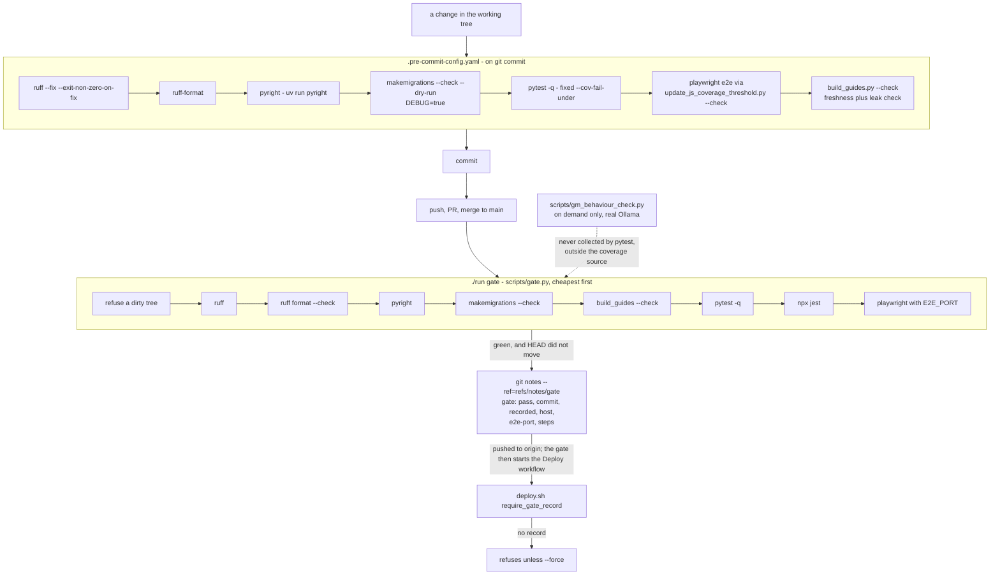

**pytest.** `pyproject.toml` `[tool.pytest.ini_options]` runs
`-n auto --dist loadgroup` (xdist, honouring `@pytest.mark.xdist_group`) with
`--cov` over all twelve local packages and `--cov-fail-under=98`. The threshold
is fixed, not ratcheted by the hook: `scripts/update_coverage_threshold.py` is a
hand-run tool (`./run update-cov`), and since issue #576 no hook rewrites or
stages a threshold.

**Jest.** `jest.config.js` — jsdom, `static/js/**/__tests__/**/*.test.js`,
`coverageThreshold.global` at statements 65 / branches 50 / functions 60 /
lines 65. That is a *different* number from `package.json`'s
`"jsCoverageThreshold": 81`, which is the Playwright/nyc figure; the config file
says so in a comment.

**Playwright.** `playwright.config.js` starts two servers: the app on
`E2E_PORT` (default 8000) and a **fake Ollama** on `E2E_PORT + 1000`, never
11434 — the suite must not reach a real model (issue #515). `e2e/fake-ollama.js`
answers only `POST /api/chat`; everything else 404s, which the app treats as a
degraded grounding step rather than a failed turn. It recognises the planning
call by the phrase "Reply with only the JSON plan" and returns plans for the
scenarios the specs exercise.

A roll the page makes through the server is pinned the same way (issue #959):
the dev server starts with `E2E_DICE_SEEDING=true`, which installs
`common.middleware.PinnedDiceMiddleware`, and `e2e/dice.js` adds an
`X-E2E-Dice-Seed` header to the one request a spec names. Inside that request
every unseeded `Roller` draws from `random.Random(seed)` (`common.rolling.pinned_dice`),
so the spec asserts the exact faces rather than retrying until real dice
cooperate. The pin is per request because four workers share one server,
and it ends when the view returns, so dice rolled while a streamed response's
body is being generated are not pinned. `settings.py` refuses the switch unless
`DEBUG` is on.

`E2E_PORT` also sets `baseURL` and the classic arena's `melee.localhost` origin,
which is how two worktrees run at once without one silently testing the other's
code. Workers are capped at 4 locally because the login limiter charges before
the password check (issue #432). Per-worker accounts (issue #620) come from
`e2e/accounts.js`: worker 0 keeps `testuser` / `admin` / `watcher`, worker *n*
gets `-w<n>` suffixes, and `global-setup.js` sizes the seeding off
`config.workers`.

**Why the unit suite cannot test model behaviour.** `./run test` mocks Ollama on
purpose — CI must never depend on a model. That leaves the model itself
unchecked, which is where the bugs in issues #342, #352, #353, #356, #363 and
#370 lived. `scripts/gm_behaviour_check.py` is the acceptance harness for it
(issue #373): real conversations through the real `/tarmar/gm/stream/` view as a
real signed-in player or Game Master, asserted against what the server filed.
Its rules truth is learned by running the code —
`characters.skills.simulate_experience_years` for the survival rule,
`characters.combat.MATRIX` for the combat question — never typed in. It runs
each of its 22 scenarios three times and reports a flake rate rather than a
pass; `STRUCTURE`, `PROVENANCE` and `CONTRADICTION` checks require 1.0, `RUBRIC`
requires 2 of 3. With Ollama unreachable it prints SKIPPED and exits 0. It is
deliberately outside `python_files` and outside the coverage source so nothing
in the gate can come to depend on a model.

**The gate record** (issue #576). `scripts/gate.py` refuses a dirty tree, runs
the eight steps, and on green writes a git note on `refs/notes/gate` naming the
commit, the time, the host, the e2e port and the steps, then pushes it. It
re-checks that HEAD did not move and the tree did not change before recording.
`deploy.sh::require_gate_record` fetches that ref (a plain fetch does not carry
`refs/notes/*`) and refuses a commit with no record unless given `--force`.
A pass on the head of `main` that ran the Tarmar canon then starts the Deploy
workflow with `--expect <sha>`; Deploy no longer starts on a merge, and
`deploy.sh` stands down, green, if `main` has moved to an unrecorded commit by
the time the run starts.

---

## 9. Deployment and operations

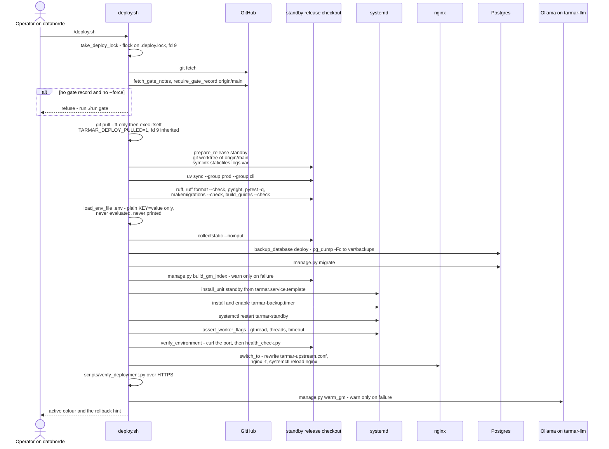

**Rollback.** `./deploy.sh rollback` takes the same lock, then
`check_rollback_migrations` before anything else: it feeds
`scripts/rollback_migrations.py` to the standby's own Python and refuses when
the database holds migrations the standby's checkout lacks (issue #575). Only
then does it verify the standby and flip the upstream. The flip itself is one
file and a reload, so rollback is seconds.

**Migration safety** has three parts: `makemigrations --check --dry-run` in the
verification step (fatal), a `pg_dump` immediately before `migrate` (a failed
dump stops the deploy), and the rollback check above. The `Character` model's
`db_table = "accounts_character"` is part of this — a rename would break the old
colour, which is still serving while `migrate` runs.

**Backups.** `backup_database(kind)` writes
`var/backups/<kind>-<UTC stamp>.dump` with `pg_dump -Fc`, `.partial` first, mode
700 on the directory, keeping `BACKUP_KEEP = 10` per kind. Two kinds: `deploy`
(every deploy) and `nightly` (`tarmar-backup.timer`, `OnCalendar=*-*-*
03:30:00`, `RandomizedDelaySec=15m`, `Persistent=true`), installed and enabled
by every deploy. `DEPLOY.md` documents the restore.

**The GM index.** `manage.py build_gm_index` writes
`var/gm-index.json` — and `var/` is shared, so both colours read one file. The
build is non-fatal: a deploy that cannot reach the embedder warns and carries
on, and `retrieve_for_query` logs a warning naming the command rather than
failing a turn.

**The LLM host.** `scripts/llm-host/` holds the Mac Studio side, with the repo
copy held to the installed one by `scripts/test_llm_host.py`:

- `tarmar-llm-ready.sh` + `com.origamisoftware.tarmar-llm-ready.plist` — at
  login and every 15 minutes: wait for `/api/version`, bootstrap or kickstart
  the Ollama agent after 30 seconds of silence, publish this Mac's `en0` address
  into datahorde's `/etc/hosts` as `tarmar-llm`, and run `manage.py warm_gm`
  over ssh when the GM model is not in `/api/ps`.
- `tarmar-gm-review.sh` + `com.origamisoftware.tarmar-gm-review.plist` — every
  minute: claim a queued review, run the Claude CLI read-only, post findings
  back.
- `README.md` documents what they deliberately do not cover: both are *user*
  agents, so nothing serves until someone is logged in, and FileVault stops an
  unattended reboot at the unlock screen.

**Worker model.** `tarmar.service.template` pins
`--worker-class gthread --workers 3 --threads 4 --timeout 60`, and
`assert_worker_flags` refuses a unit without them (issue #361). Under the
default sync worker the arbiter's timeout doubles as a cap on request duration,
which killed any GM turn over 30 seconds mid-stream and reported a healthy stack
as a connection error. Long turns are bounded in the application instead, by
`GM_STREAM_BUDGET_SECONDS` (default 300), which ends them with a message the
player can read.

**Where logs go.**

| What | Where |
| --- | --- |
| Audit lines (`origami.audit`) | `logs/audit.log` in the main checkout — `RotatingFileHandler`, 10 MB, 5 backups; production only |
| Access logs and tracebacks | the systemd journal for `tarmar-blue` / `tarmar-green` (gunicorn runs `--access-logfile -` and `--error-logfile -`) |
| The apps' own records (`gm`, `battle`, `characters` and the rest), INFO and above | the same journal, in the `server` format (timestamp, level, logger name), through the shared `server` handler in `LOGGING` (issue #38) |
| Deploy output | the operator's terminal; `./deploy.sh status` shows each colour's revision |
| Ollama and the ready agent | `~/Library/Logs/ollama/` on the Mac Studio |
| GM turns | not a log — `GMTurnRecord` plus `GMEvent` rows, read with `manage.py gm_transcript <id>` or the chat page's Transcript button |

---

## 10. Where to look

| I want to change... | Start here |
| --- | --- |
| A game rule about attributes, skills or aging | its number is the canon's `skill-rules.json` (schema in `characters/skill_rules.py`; the default canon's copy in `reference/default_canon/`), its procedure `characters/skills.py`; drift between the default file and the pages is pinned by `characters/tests/test_rules_consistency.py` and `test_dice_fidelity.py` |
| A derived stat on the sheet | the property on `characters/models.py::Character`, then the module it delegates to (`skills.py`, `equipment.py`, `movement.py`, `dice.py`) |
| Character creation or point buy | `characters/views/characters.py::character_create`, `characters/dice.py::roll_all_character_stats` / `build_point_buy_character_stats`, `static/js/point-buy.js` |
| A limit or bound (attribute cap, name length, equipment size) | `characters/constants.py` |
| The equipment catalog, encumbrance, gaits | the canon's `equipment.json` and `equipment-rules.json` (schemas in `characters/equipment_rules.py`; the default canon's copies in `reference/default_canon/`), read through `characters/equipment.py` and `characters/movement.py`; drift between the default files and the pages is pinned by `characters/tests/test_rules_consistency.py` and `test_dice_fidelity.py`, and `characters/tests/test_catalog_follows_the_canon.py` and `test_equipment_rules_follow_the_canon.py` seat invented files to prove the readers follow them |
| Attack resolution | `characters/attack.py::resolve` and `characters/combat.py`; the panel is `static/js/attack-panel.js` |
| What a character export contains | `character_export/export_utils.py::EXPORTABLE_FIELDS` — import reads the same list |
| Any write to a character record | `characters/services.py` — the HTTP views and the GM executor both go through it |
| The incomplete-character rule | `Character.missing_parts` / `is_complete` / `CharacterQuerySet.playable`, partial `characters/templates/characters/_incomplete_marks.html` |
| Battle setup, the roster builder | `battle/views.py` (`battle_setup*`), `battle/services.py::start_draft`, `battle/templates/battle/battle_setup.html`, `static/js/battle-setup.js` |
| Turn order, phases, damage | the pinned `tarmar_engine` package; `battle/engine/*.py` are re-exports and `battle/tests/test_rules_drift.py` guards the phase list |
| How a turn is persisted or paused | `battle/services.py::advance_turn`, `_advance_turn_once`, `_human_decider` |
| Who may control a seat | `battle/access.py::decides_for` / `can_control`, `battle/control.py` |
| A new rules profile | `battle/profiles.py` (`BattleProfile` subclass), `battle/persistence.py::PROFILE_CHOICES`, `battle/viewmodel.py` |
| What the arena draws | `battle/viewmodel.py` for the payload, `static/js/battle.js` for the drawing, `battle/templates/battle/_arena.html` |
| The GM's system prompt | `gm/engine.py` — the `SECTION_*` constants, the `section_*()` builders that state the canon's rules numbers (`section_core()`, `section_character_creation()`, `section_combat()`, `section_equipment()`, `section_plan_schema()`, `section_dm_authority()`; issue #68) and `system_prompt_sections()` |
| Adding a GM action | `gm/turn_engine/policy.py::ACTION_NAMES`, `plan.py::_read_action`, `executor.py::RecordsExecutor.run`, `gm/engine.py::section_plan_schema` |
| What the model is told about the session | `gm/turn_engine/state.py::state_block` |
| The two model calls' wording | `gm/turn_engine/messages.py` |
| Refusals and who may do what | `gm/turn_engine/policy.py::TurnPolicy` |
| Campaign records (place, time, people, threads) | `gm/models.py` (`CampaignState`, `SceneEntity`, `StoryThread`, `SupplyItem`) and `executor.py::_campaign` |
| Streaming frames or the chat client | `gm/views.py::_plan_turn.event_stream`, `static/js/chat.js` |
| A side panel tab | one include plus one button in `gm/templates/gm/chat.html`, then `window.gmPanel.registerTab` |
| Long-session behaviour | `gm/summary.py` (the fold), `gm/retrieval.py` (the context guard) |
| The canon index | `gm/retrieval.py`, `gm/management/commands/build_gm_index.py` |
| Rules numbers the GM may quote | `gm/rules_lookup.py::RULES` |
| Debugging a GM session | `manage.py gm_transcript <id>`, `gm/transcript.py`, the `GMTurnRecord` and `GMEvent` rows |
| The offline CLI | `cli/gm.py`, `cli/tarmar.py` |
| A reference page | `reference/content/<path>.md` **and** an entry in `reference/nav.py` — a page absent from the nav is unreachable |
| A generated guide | the source page or `reference/nav.py` `guides` key; `scripts/build_guides.py` regenerates `build/` |
| The passphrase gate or a public path | `common/middleware.py`, `common/public_paths.py`, `common/gate.py` |
| A rate limit | `common/decorators.py` for JSON endpoints, `common/rate_limit.py` for login and the gate |
| Role checks | `common/mixins.py`, `battle/access.py`, `characters/models.py::characters_visible_to` |
| Site settings or a new env var | `tarmar_studio/settings.py`; add it to the README table and `.env.example` |
| The deploy | `deploy.sh`, `tarmar.service.template`, `nginx/`, `DEPLOY.md` |
| The check that gates a deploy | `scripts/gate.py`, `.pre-commit-config.yaml` |
| The e2e suite or its fake model | `e2e/`, `playwright.config.js`, `e2e/fake-ollama.js` |
| Model behaviour against a real model | `scripts/gm_behaviour_check.py` |
| The Mac Studio agents | `scripts/llm-host/` (and `scripts/test_llm_host.py`, which holds the repo copies to the installed ones) |
